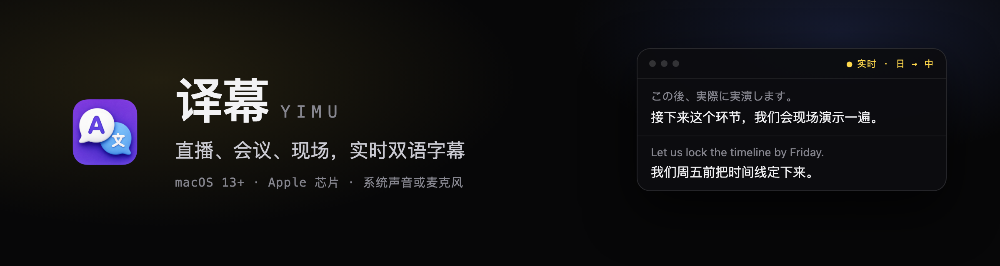
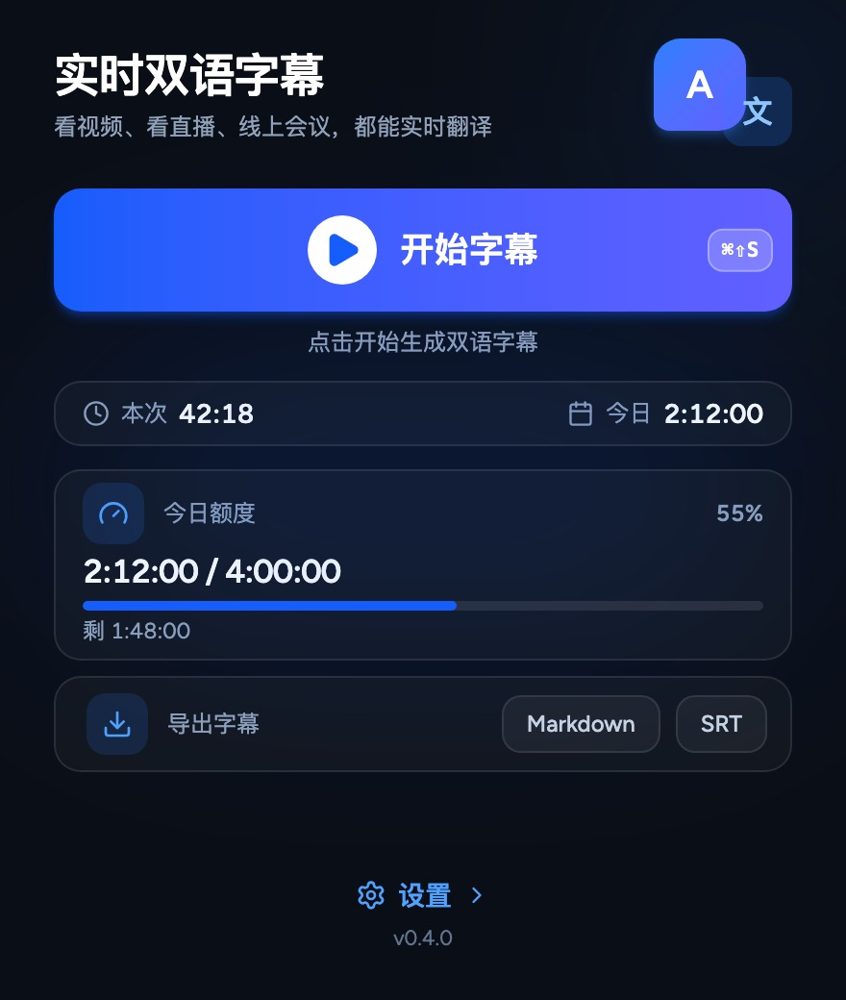
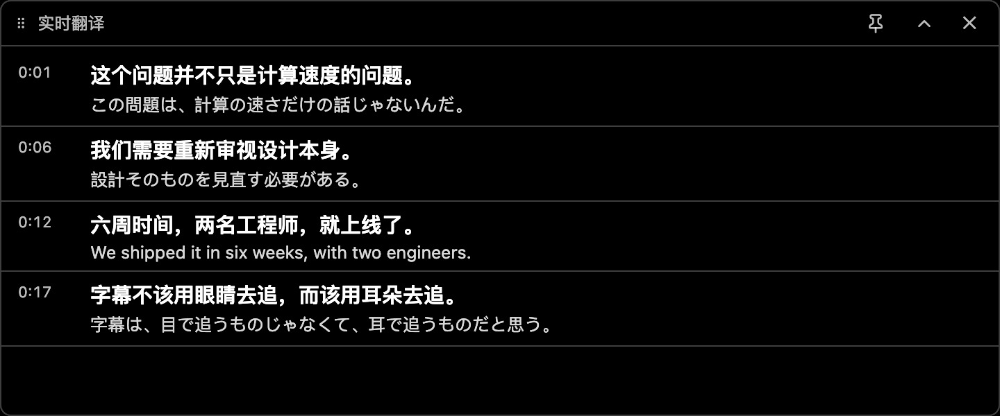
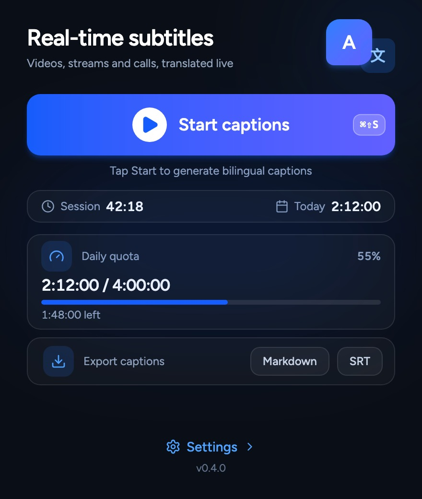
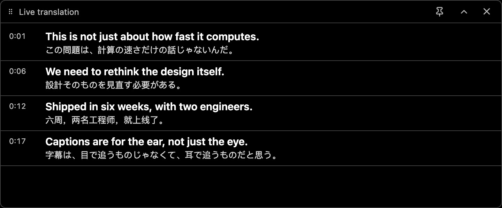

<p align="center">
  
</p>

<p align="center">
  <a href="https://github.com/kulebbb/yimu-releases/releases/latest"><b>⬇ 下载最新版</b></a>
  &nbsp;·&nbsp;
  <a href="https://yimu.dev">官网</a>
  &nbsp;·&nbsp;
  <a href="https://x.com/LiangXr4">X @LiangXr4</a>
  &nbsp;·&nbsp;
  <a href="https://github.com/kulebbb/yimu-releases/releases">全部版本</a>
</p>

<p align="center"><sub>中文 · <a href="#english">English</a></sub></p>

# 译幕：看清正在播放的声音

外语直播、跨国会议、现场讲座。系统正在播放的声音，或者身边正在说的话，实时变成双语字幕，浮在所有窗口最上层。

不用等回放，不用等字幕组，也不用视频自带字幕轨。

- **实时**：说一句出一句，日→中、英→中、中→日都行，源语言自动识别
- **两路音源**：系统声音或麦克风，一键切换。线上采集系统声音，现场切到麦克风
- **悬浮字幕窗**：置顶显示，看视频、开会、演示都不挡操作
- **能导出**：一场结束导出 SRT 或 Markdown，复盘、剪辑都能用

<p align="center"></p>

## 安装（3 步，两分钟）

1. 到 [Releases](https://github.com/kulebbb/yimu-releases/releases/latest) 下载最新的 `.dmg`
2. 打开 dmg，把 `Yimu`（Finder 里显示为「译幕」）拖进「应用程序」
3. 首次打开会被 macOS 拦下（安装包未做 Apple 公证）：右键 App → **打开**，或在终端执行：

   ```bash
   xattr -dr com.apple.quarantine "/Applications/Yimu.app"
   ```

装好之后，新版本会在 App 内提示更新，托盘菜单里也有「检查更新…」。

## 用之前需要知道

- **系统要求**：macOS 13 或更高，仅支持 Apple 芯片（M 系列）。Intel Mac 暂不支持
- **需要自备 API Key**：语音识别和翻译默认走阿里云百炼，需要你自己的阿里云账号和 API Key，没有 Key 无法使用
- **按量计费，不订阅**：语音识别挂牌价约 ¥1.19 / 小时，翻译按 token 另计。费用由阿里云直接向你收取，译幕不加价
- **不录屏**：只取声音，画面不出本机；音频发到你自己的阿里云账号

## 常见问题

**第一次打开提示「无法验证开发者」怎么办？**
安装包是自签名、没有 Apple 公证。右键点 App → 选「打开」；或者在「系统设置 → 隐私与安全性」里点「仍要打开」。

**支持 Intel Mac 吗？**
暂不支持，当前安装包只有 Apple 芯片（aarch64）版本。

**这个仓库为什么没有源码？**
源码私有，本仓库只分发安装包和自动更新清单。功能和定价见[官网](https://yimu.dev)。

**会用掉多少钱？**
取决于你听了多久。一小时外语直播的语音识别费约 ¥1.19，翻译费按 token 另算，设置页里有实时估算。



## 链接

- 官网：[yimu.dev](https://yimu.dev)
- X：[@LiangXr4](https://x.com/LiangXr4)
- 全部版本与更新日志：[Releases](https://github.com/kulebbb/yimu-releases/releases)
- 发版与维护流程（维护者）：[MAINTENANCE.md](MAINTENANCE.md)

> 本仓库只分发安装包与更新清单，源码不公开，不提供开源许可证。

---

<a id="english"></a>

# Yimu: real-time bilingual captions for macOS

Yimu turns the audio your Mac is already playing, or the voice of the person next to you, into bilingual subtitles in real time and floats them above every window.

Live streams in a foreign language, cross-border meetings, on-site talks: no replay, no waiting for a fansub group, no caption track needed.

- **Real time**: one sentence in, one sentence out. Source language is detected automatically (Japanese→Chinese, English→Chinese, Chinese→Japanese and more)
- **Two audio sources**: system audio or microphone, one click apart
- **Floating caption window**: always on top, never blocks your clicks
- **Export**: SRT or Markdown when a session ends

<p align="center"></p>

## Install (3 steps, about 2 minutes)

1. Download the latest `.dmg` from [Releases](https://github.com/kulebbb/yimu-releases/releases/latest)
2. Open the dmg and drag `Yimu` into Applications
3. macOS will block the first launch (the build is not notarized by Apple): right-click the app and choose **Open**, or run:

   ```bash
   xattr -dr com.apple.quarantine "/Applications/Yimu.app"
   ```

After the first install, later versions update from inside the app. The tray menu also has **Check for updates**.

## Before you install

- **Requirements**: macOS 13 or later, Apple silicon (M-series) only. Intel Macs are not supported yet
- **Bring your own API key**: speech recognition and translation go through Alibaba Cloud Model Studio (DashScope) by default, so you need an Alibaba Cloud account and API key. Without a key nothing runs
- **Pay as you go, no subscription**: recognition is about ¥1.19 per hour at list price, translation is billed per token. Alibaba Cloud charges you directly, Yimu adds no markup
- **No screen recording**: audio only, the picture stays on your Mac, the audio goes to your own Alibaba Cloud account

## FAQ

**macOS says it cannot verify the developer.**
The build is self-signed and not notarized. Right-click the app and choose **Open**, or allow it under System Settings → Privacy & Security.

**Is there an Intel build?**
Not yet. The current package is Apple silicon (aarch64) only.

**Where is the source code?**
The source is private. This repository only ships installers and the auto-update manifest. Features and pricing are on the [website](https://yimu.dev).

**How much will it cost?**
It depends on how much you listen to. One hour of foreign-language live audio costs about ¥1.19 in recognition, plus translation by token. The settings screen shows a live estimate.



## Links

- Website: [yimu.dev](https://yimu.dev)
- X: [@LiangXr4](https://x.com/LiangXr4)
- All releases and changelogs: [Releases](https://github.com/kulebbb/yimu-releases/releases)
- Release process (maintainers): [MAINTENANCE.md](MAINTENANCE.md)

> This repository only distributes installers and the update manifest. The source is private and no open-source license is granted.
